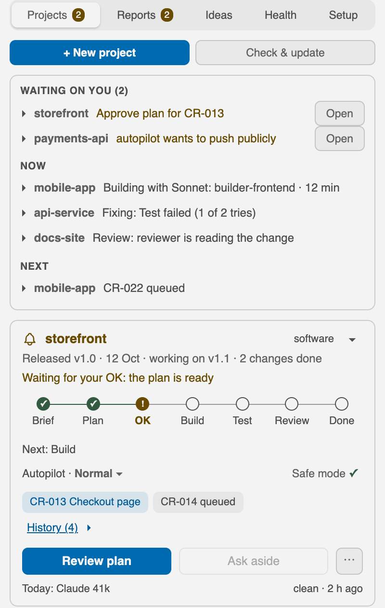
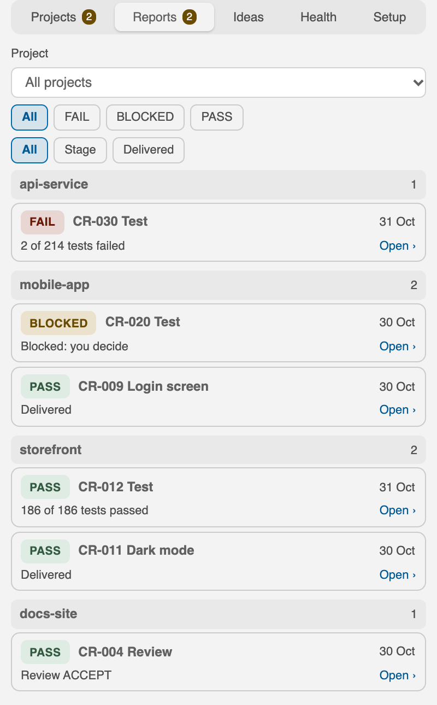
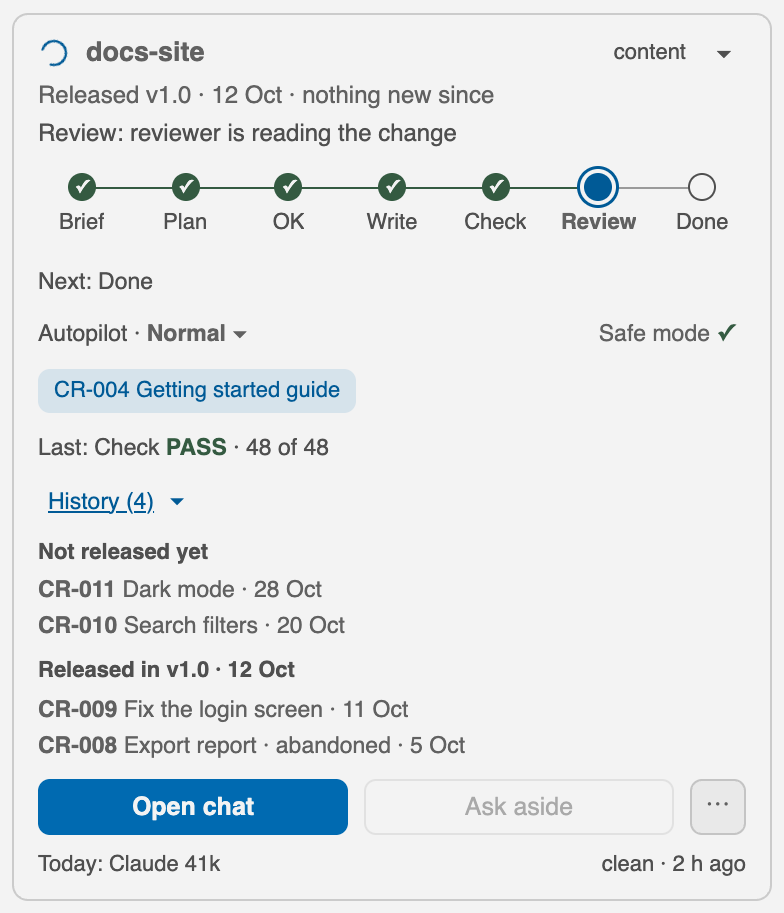
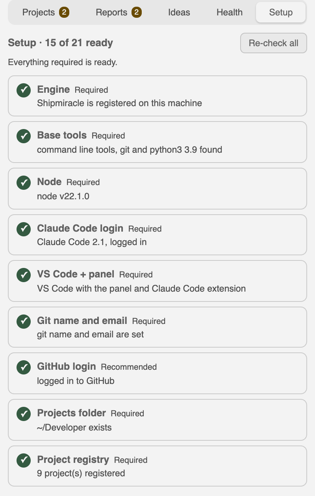

<p align="center">
  
</p>

<p align="center">
  <b>Shipmiracle keeps every project you build with AI agents in one VS Code panel, with plans, approvals, memory and status for each project.</b><br>
  Free and open source. No API key. Runs locally on macOS, Linux and Windows (through WSL 2); Linux and WSL 2 are experimental.
</p>

<p align="center">
  <a href="LICENSE"></a>
  
  
  
</p>

<p align="center">
  <a href="#install">Install</a> &nbsp;·&nbsp;
  <a href="#how-it-works">How it works</a> &nbsp;·&nbsp;
  <a href="#features">Features</a> &nbsp;·&nbsp;
  <a href="docs/index.md">Docs</a>
</p>

<p align="center">
  <picture>
    <source media="(prefers-color-scheme: dark)" srcset="docs/images/panel-dark.png">
    
  </picture>
  <br>
  <sub>The panel, with sample projects.</sub>
</p>

## Why Shipmiracle

- **One place for every project.** See what is running, what failed and what waits on you, across all your AI projects.
- **Plans and approvals.** Plans wait for your OK. A public push or a deploy stops and asks. A build is not finished until a separate verifier has run the real tests.
- **Memory per project.** A new chat picks up where you stopped. Handoff lives in plain files in your repo (`STATUS.md`, `DECISIONS.md` and `memory/`), with no hidden database.
- **Agents with defined roles.** A planner, builders, a verifier and a reviewer, each on the model that fits the job: Opus plans and reviews, Sonnet builds and tests, Haiku writes short summaries.

Shipmiracle works with the Claude Code you already use, with the login you already have. Its command is `shipm`.

## How it works

Three steps from idea to done:

1. **You describe it.** Say what you want in plain words. The change gets an id, for example CR-013.
2. **The team plans, you say OK.** The panel shows "Waiting for your OK: the plan is ready". You read the plan and say yes or no.
3. **It builds, tests and reviews.** A separate verifier runs the real tests. A failed test is fixed and retried; after two failures the change waits for your choice. A reviewer who did not write the change checks the result.

Every change walks seven stages:

| Stage | What happens | Who | Model |
|---|---|---|---|
| 1. Brief | You say what you want; criteria are set before planning | Scoper | Sonnet |
| 2. Plan | A plan with acceptance criteria | Planner | Opus |
| 3. Your OK | The plan waits for you | You | n/a |
| 4. Build | The change is made | Builder | Sonnet |
| 5. Test | The real tests run, by another agent | Verifier | Sonnet |
| 6. Review | The change is reviewed, never edited | Reviewer | Opus |
| 7. Done | The result is delivered; a short summary is written from the report facts (PASS, FAIL or BLOCKED) | Reporter | Haiku |

At a hard stop (for example a public push) everything pauses until you decide.

## The team

Ten roles, each on the right model. Judgement goes to Opus, volume to Sonnet, short summaries to Haiku.

| Role | Job | Model |
|---|---|---|
| Scoper | Sets criteria before planning | Sonnet |
| Planner | Plans with acceptance criteria | Opus |
| Designer | Writes the UI spec | Sonnet |
| Builder | Docs, scripts, config | Sonnet |
| Frontend builder | Screens, styles, accessibility | Sonnet |
| Backend builder | Services, APIs, data | Sonnet |
| Ops builder | CI, builds, Docker | Sonnet |
| Verifier | Runs the real tests | Sonnet |
| Reviewer | Reviews, never edits | Opus |
| Reporter | Summaries, three lines max | Haiku |

## Features

44 features in 7 groups. Open a group for the details.

<details>
<summary><b>Team</b> · 7 features</summary>

| Feature | What it does |
|---|---|
| **Ten named roles** | Scoper to reporter, installed once. |
| **A model per role** | Opus plans, Sonnet builds, Haiku summarises. |
| **A separate verifier** | Tests run by another agent. |
| **Two review lenses** | Correctness, or risk. |
| **An agent cap** | Limits how many agents run. |
| **A team table per project** | Who is on each project, in a table. |
| **Skills you approve** | Pinned to a commit. |

</details>

<details>
<summary><b>Flow and approvals</b> · 6 features</summary>

| Feature | What it does |
|---|---|
| **Seven stages** | Brief to Done. |
| **Your OK is yours** | Only your own words in the chat approve a plan. |
| **Change requests** | Each change gets an id: `shipm cr open`, `shipm cr list`, `shipm cr show`, `shipm cr start`. |
| **Retry, then ask** | Two failed tries, then it waits for you. |
| **A flow gate** | Says what was skipped. |
| **Autopilot with a charter** | Bounded runs that stop at hard stops. |

</details>

<details>
<summary><b>VS Code panel</b> · 8 features</summary>

| Feature | What it does |
|---|---|
| **Projects tab** | Now, Next, Waiting on you. |
| **Reports tab** | PASS, FAIL, BLOCKED, failures first. |
| **Ideas tab** | Every project's ideas in one list. |
| **Health tab** | Frozen chats and stuck steps. |
| **Setup tab** | The `shipm init --check` list with Fix, Skip, Re-check. |
| **Timeline and releases** | Last release, changes since, History. |
| **Ask aside** | A side question without leaving your chat. |
| **Prefilled, never run** | You read and run each command. |

</details>

<details>
<summary><b>Memory</b> · 5 features</summary>

| Feature | What it does |
|---|---|
| **Handoff in files** | `STATUS.md`, `DECISIONS.md` and `memory/` in every project. |
| **Project templates** | A base plus web, iOS, Python, API, notes. |
| **One engineering standard** | The same rules in every project's `CLAUDE.md`. |
| **An ideas list** | `docs/FEATURE-IDEAS.md` per project. Add with `shipm idea add`. |
| **A nudge before chats drift** | A hint at 200k tokens, a strong one at 300k. |

</details>

<details>
<summary><b>Automation</b> · 7 features</summary>

| Feature | What it does |
|---|---|
| **An awake guard** | Keeps the Mac awake for work. macOS. |
| **Awake while Claude works** | Idle sleep is held off for each call. |
| **Continue at the usage limit** | The Mac stays awake until the limit resets. |
| **Keep going** | Claude is sent back to finish. |
| **A daily job** | Every day at 09:00. |
| **A weekly tidy report** | Read-only disk use per project. |
| **Long jobs with a deadline** | `shipm bg 30 -- cmd` ends the job when time is up. |

</details>

<details>
<summary><b>Safety</b> · 6 features</summary>

| Feature | What it does |
|---|---|
| **A safety gate in hooks** | Each step is checked. Skips are said out loud. |
| **Hard stops** | A public push or deploy waits for you. |
| **A push check** | An offline pre-push guard applies your registry rules. |
| **Owner commands stay out of chat** | Setup and uninstall refuse to run in a chat. |
| **Local, and masked** | No network calls of its own. Secrets are masked. |
| **Hooks fail open** | A missing hook shows "gate OFF" instead of failing. |

</details>

<details>
<summary><b>Setup</b> · 5 features</summary>

| Feature | What it does |
|---|---|
| **Guided setup** | `shipm init` is safe to re-run and can be resumed. |
| **Check only** | `shipm init --check` and `shipm doctor` change nothing. |
| **Quick setup** | Five choices in one card. |
| **macOS, Linux, WSL 2** | macOS first. Linux and WSL 2 are experimental. |
| **Reversible** | `shipm uninstall` shows a dry run, then reverses writes. |

</details>

## Screenshots

Real renders of the panel with sample projects (light and dark follow your GitHub theme).

<table>
  <tr>
    <th align="center">Reports</th>
    <th align="center">Timeline</th>
    <th align="center">Setup</th>
  </tr>
  <tr>
    <td valign="top">
      <picture>
        <source media="(prefers-color-scheme: dark)" srcset="docs/images/reports-dark.png">
        
      </picture>
    </td>
    <td valign="top">
      <picture>
        <source media="(prefers-color-scheme: dark)" srcset="docs/images/timeline-dark.png">
        
      </picture>
    </td>
    <td valign="top">
      <picture>
        <source media="(prefers-color-scheme: dark)" srcset="docs/images/setup-dark.png">
        
      </picture>
    </td>
  </tr>
</table>

## Install

Run these in a normal terminal, not inside a Claude chat (setup is an owner command and refuses to run in a chat).

```
git clone https://github.com/alsharifabdull/shipmiracle ~/Developer/shipmiracle
cd ~/Developer/shipmiracle
./bin/shipm init
```

`shipm init` is guided and safe to re-run: a step that is already done does nothing. Only looking? `shipm init --check` only reports (read only);
`shipm init --check --json` prints the same as data. Step by step: [docs/INSTALL.md](docs/INSTALL.md).

### Requirements

- macOS, Linux, or Windows with WSL 2 (see Supported systems)
- Claude Code with a Pro or Max login
- VS Code
- git
- python3 3.9 or newer
- node 18 or newer

How to get the tools (Shipmiracle only prints these lines; it never runs a package manager or `sudo` for you):

| Tool | macOS | Ubuntu / Debian / WSL 2 | Fedora |
|---|---|---|---|
| git, python3 | `xcode-select --install` | `sudo apt install git python3` | `sudo dnf install git python3` |
| node 18+ | `brew install node` | `sudo apt install nodejs npm`, or [nvm](https://github.com/nvm-sh/nvm) | `sudo dnf install nodejs npm` |
| GitHub CLI (optional) | `brew install gh` | `sudo apt install gh` | `sudo dnf install gh` |
| gitleaks (for `release-check`) | `brew install gitleaks` | a [release binary](https://github.com/gitleaks/gitleaks/releases) | same |

On Windows: run `wsl --install`, open Ubuntu, and do everything above inside Ubuntu. Keep your projects in the Linux home folder
(for example `~/Developer`), not under `/mnt/c`.

### Supported systems

Linux and WSL 2: experimental.

| System | Support | What that means |
|---|---|---|
| macOS | First-class | Everything works, including the awake guard. |
| Linux (Ubuntu, Debian, Fedora) | Experimental | Test suites run in CI and in a Linux container (`bin/test-linux`) with fake tools. Keep-awake and the daily timer use systemd when it is present. |
| Windows through WSL 2 | Experimental | Treated as Linux; use VS Code with Remote - WSL. |
| Windows, native | Not supported | `shipm` stops at once with "use WSL 2" and changes nothing. |

The awake guard (battery, lid, thermal) is macOS only. It is not available on Linux or WSL 2.

### Your first project

1. **Create it.** In the panel click **+ New project**, or from the clone run `./bin/new-project my-shop --type web --about "A small online shop"`
   (types: web, ios, python, api, home, notes, other). It makes the folder from the templates (with `docs/STATUS.md`, `docs/DECISIONS.md` and `docs/memory/`),
   the team roles, a git repo with a first commit and, unless you pass `--no-github`, a GitHub repository. The project appears in the panel.
2. **Open the folder in VS Code** and start a Claude Code chat there.
3. **Describe the change.** Say what you want in the chat, or open it yourself from the project folder: `shipm cr open "Add a checkout page"`.
4. **Approve the plan.** When the card reads "Waiting for your OK: the plan is ready", click **Review plan**, read it, and write your OK in the chat yourself.
5. **Watch it build.** The panel shows the seven steps; the Reports tab shows PASS, FAIL or BLOCKED. List your changes with `shipm cr list`.

### Everyday commands

| Command | What it does |
|---|---|
| `shipm init --check` | Shows the setup state and what is missing; changes nothing |
| `shipm init --prefs` | Asks the five quick-setup choices again |
| `shipm doctor` | Health rows; changes nothing |
| `shipm projects` | Lists your registered projects |
| `shipm cr open "TITLE"` | Opens a change request in the current project |
| `shipm cr list` | Lists the change requests |
| `shipm cr show --next` | Shows the next step of the active change request |
| `shipm team show` | Shows the project's team table |
| `shipm idea add "text"` | Adds a feature idea to the project's list |
| `shipm tidy --all` | Read-only summary of disk use per project |
| `shipm release status` | Last release and changes since (read only) |
| `shipm bg 30 -- <command>` | Runs a long job and ends it after 30 minutes |
| `shipm uninstall` | Dry run of what an uninstall would reverse |

`shipm --help` lists every command.

### What it changes (exact list)

Setup writes only the following, and records each write in `~/.local/state/shipmiracle/v1/install-manifest.json` so it can be undone:

- `~/.config/shipmiracle/config.json` and `~/.config/shipmiracle/registry.json` (your settings and your project list)
- the shipmiracle-owned hook entries in `~/.claude/settings.json` (a backup is made first; other entries are left byte for byte alone)
- the ten agent files in `~/.claude/agents/`
- `~/.local/state/shipmiracle/v1/` (state, logs, backups)
- a symlink `~/.local/bin/shipm` pointing at this clone
- the VS Code extension `shipmiracle.shipmiracle-panel` (and `anthropic.claude-code` if you answer yes)
- optional, only if you ask for it by name (`shipm init --step guard`; `--yes` alone never does it): on macOS `~/Library/LaunchAgents/com.shipmiracle.guard.plist` and `com.shipmiracle.daily.plist`. The guard job runs a watcher about every minute that, with automatic cleanup on (the default), ends processes it can prove are orphans of a dead chat and deletes Claude task output files older than 7 days in `/private/tmp/claude-<uid>`;
  on Linux and WSL 2 the daily job as a systemd user timer (`~/.config/systemd/user/com.shipmiracle.daily.service` and `.timer`, no root)
- a sudoers line is only printed for you to read; it is never written

It never edits `~/.gitconfig`, your shell startup files, or anything inside your projects unless you create a project with it.
What is logged and where: [docs/PRIVACY.md](docs/PRIVACY.md).

### Upgrade

There is no separate updater. The `shipm` command and the hooks run from your clone, so updating is:

```
cd ~/Developer/shipmiracle
git pull
./bin/shipm init
./bin/install-shipm-ext
```

`git pull` brings the new code. `shipm init` is safe to re-run and re-checks every row. `bin/install-shipm-ext` reinstalls the VS Code panel from the clone;
afterwards run "Developer: Reload Window" in VS Code. The panel's **Check & update** button updates tools, skills and extensions; it does not pull this repository.

### Uninstall

```
bin/shipm uninstall            # dry run: lists what would be reversed
bin/shipm uninstall --apply    # reverses each write, newest first, only where the file is still as setup left it
bin/shipm uninstall --apply --purge   # also removes ~/.config/shipmiracle and ~/.local/state/shipmiracle (asks you to type a confirmation)
```

It never deletes your project repositories, the projects folder, your Claude or GitHub logins, Homebrew packages, or this
clone (it prints the `rm -rf` line for you to run yourself). Details: [docs/UNINSTALL.md](docs/UNINSTALL.md).

## Safety model

- **Everything is local.** No secrets or API keys are stored; setup never asks for one. Shipmiracle makes no network calls of its own.
- **Your OK is yours.** An approval counts only when you write it yourself. Owner commands (setup, uninstall, anything that changes configuration) refuse to run inside a Claude chat.
- **Hard stops.** Autopilot runs in bounded runs; at a hard stop (a public push, a deploy) it pauses and waits for you.
- **A flow gate** in the hooks says what was skipped. The level starts at `warn` (it says what was skipped; it does not refuse). Raise it to enforce.
  Safe mode "Off" is set by hand in `config/flow.json`; the panel offers On and Warnings only.
- **Off by default:** automatic git push, the guard daemon, notifications and Remote Control.
- **Hooks fail open.** If a hook script goes missing, Claude Code shows "Shipmiracle gate OFF" instead of failing every event.
- **Tests do not touch your real settings.** Every suite gets a fresh temporary home, and `bin/test-all` fingerprints your real `~/.claude/settings.json` and
  `~/.config/shipmiracle` before and after and fails loudly if either changed. `shipm` itself refuses (under `SHIPMIRACLE_TEST=1`) to write into the real
  `~/.claude`.
- **`shipm release-check`** scans a tree for secrets, personal paths and files that must not be published, and never prints a matched value.
- **Masking.** Detail text shown in the panel is masked for secrets; this is best effort, not a guarantee.

## Limitations

- Linux and WSL 2 are experimental. Native Windows is not supported: `shipm` stops with "use WSL 2". The awake guard is macOS only.
- Built for one owner on one machine; not a team tool yet.
- The panel is for VS Code. There is no Cursor or JetBrains panel, no hosted dashboard and no phone push.
- It needs Claude Code with your own Pro or Max login. Shipmiracle does not store your login and does not call any model itself.
- It does not make agents correct. It makes mistakes visible and puts a person at the decision points.
- It is not a sandbox. Code running as you can still do what you can do, including writing Shipmiracle's own files. A sandbox or a separate account contains that.
- The default confirmation is typed, and a program launched in the same terminal window can answer it. A Touch ID prompt or password dialog (macOS), or a separate standard-user account, stops that.
- On Linux and WSL 2, `shipm uninstall` does not remove the daily systemd timer yet; [docs/UNINSTALL.md](docs/UNINSTALL.md) lists the lines to run.
- Setup finds your Claude Code login by calling the `claude` command line; a future version that changes its output may need a manual check.
- The product text is English. The panel displays right-to-left text, such as Arabic report titles.
- Python 3.9 or newer and node 18 or newer are required.

## FAQ

<details>
<summary><b>Is it really free?</b></summary>

Yes. MIT licensed. You need your own Claude Pro or Max plan.

</details>

<details>
<summary><b>Do I need an API key?</b></summary>

No. It drives Claude Code with the login you already have.

</details>

<details>
<summary><b>Does it send my code anywhere?</b></summary>

No. It runs locally and makes no network calls of its own. It runs `git`, `gh`, `claude` and `code`, which you already use. See [docs/PRIVACY.md](docs/PRIVACY.md).

</details>

<details>
<summary><b>Do I still use Claude Code?</b></summary>

Yes. Shipmiracle works with the Claude Code you already use. It keeps your AI projects organized, with plans, approvals, memory and status for each one.

</details>

<details>
<summary><b>Is it affiliated with Anthropic?</b></summary>

No. It is independent. Claude and Claude Code are Anthropic's products.

</details>

Something is wrong? Start with [docs/TROUBLESHOOTING.md](docs/TROUBLESHOOTING.md), then [SUPPORT.md](SUPPORT.md).

## Documentation, contributing and security

- Documentation: start at [docs/index.md](docs/index.md). What shipped: [CHANGELOG.md](CHANGELOG.md).
- Contributing: this repository is a one-way export; see [CONTRIBUTING.md](CONTRIBUTING.md) and [CODE_OF_CONDUCT.md](CODE_OF_CONDUCT.md).
- Security: report a vulnerability privately, see [SECURITY.md](SECURITY.md).
- License: MIT, see [LICENSE](LICENSE).

Not affiliated with or endorsed by Anthropic. Claude and Claude Code are Anthropic's products; you need your own account.
